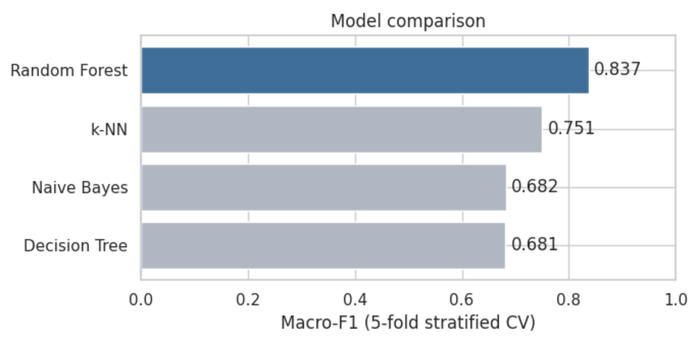
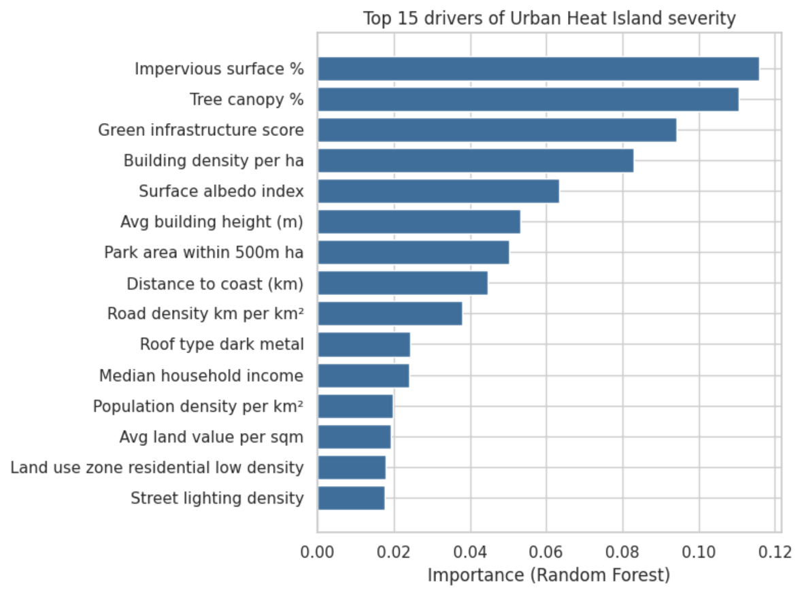
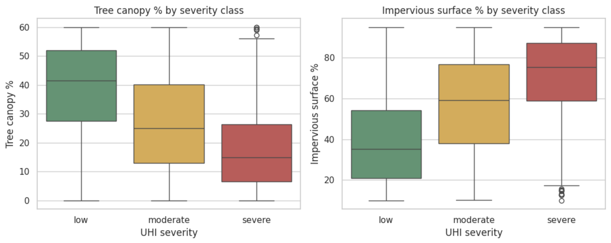
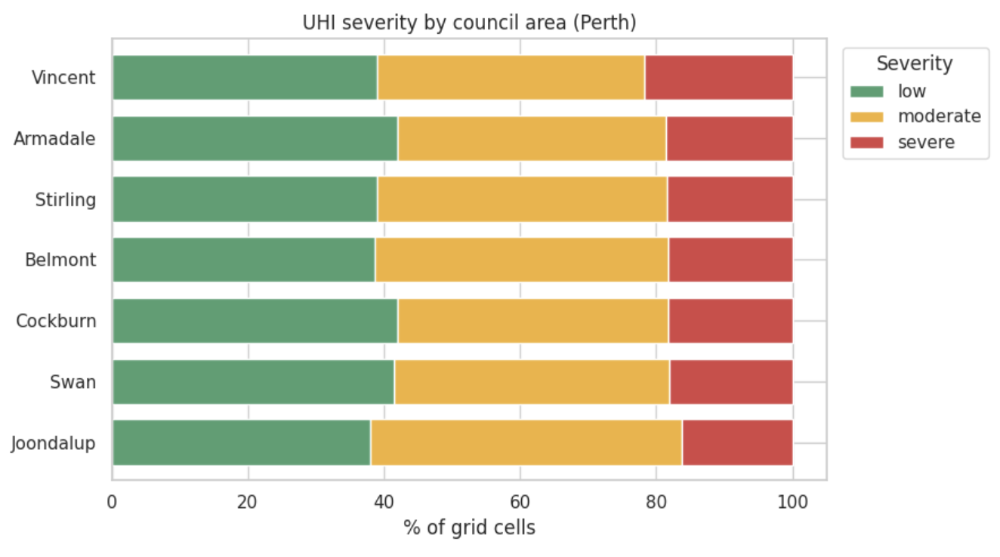
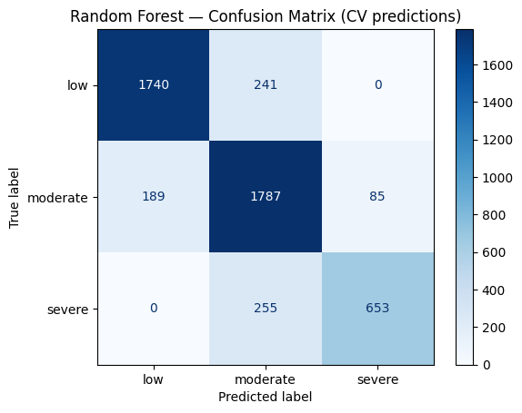

# Predicting Urban Heat Island Severity in Perth

Machine learning project that classifies the **Urban Heat Island (UHI) severity** (low, moderate or severe) of grid cells across the Perth metropolitan area, using urban, environmental and socio-economic features.

> Originally built for COMP5009 Data Mining at Curtin University (2026), then extended as a portfolio project.

## Why it matters
Urban heat islands make some suburbs much hotter than others, which affects health, energy use and liveability. Predicting which areas are most at risk helps councils prioritise interventions such as tree planting, cool roofs and green space.

## Data
- 5,000 labelled grid cells and 500 unlabelled cells, stored in a SQLite database
- About 30 features, including tree canopy %, surface albedo, building density and height, population density, household income, land use zone and council area
- The dataset was provided by Curtin University for coursework and is not included in this repository
- Target: `uhi_severity_class` (low 40%, moderate 42%, severe 18%, so the classes are imbalanced)

## Approach
1. **Data quality checks and cleaning**
   - Standardised inconsistent council names (14 to 7 categories), which revealed and removed 50 hidden duplicate rows
   - Replaced physically impossible values (negative albedo or building density, household size below 1) and imputed them with the median
   - Dropped a column that was 90% missing and a constant column
2. **Leakage-free pipeline** in scikit-learn: imputation, one-hot encoding and scaling, all fitted on training folds only
3. **Model selection**: stratified 5-fold cross-validation with GridSearchCV, scored by macro-F1 to handle class imbalance
4. **Evaluation**: macro-F1, accuracy, precision, recall, confusion matrix and feature importance

## Results
Random Forest was the best model, with a **macro-F1 of 0.837** in 5-fold stratified cross-validation.



### What drives heat severity?
Hard surfaces and a lack of greenery matter most. Impervious surface %, tree canopy %, green infrastructure score and building density were the top 4 features.



Severe areas have a median tree canopy of about 15%, against about 41% in low-severity areas. They also have far more impervious surface (median about 75% against 35%).



### Severity across Perth councils
The mix of severity classes is fairly similar across the 7 councils. Vincent has the largest share of severe cells and Joondalup the smallest. Local land cover therefore matters more than which council an area is in.



<details>
<summary>Confusion matrix (Random Forest)</summary>


</details>

## Recommendations
Based on the model and the analysis, councils looking to reduce urban heat should:
1. **Prioritise tree planting** in grid cells with low canopy cover, since tree canopy % is one of the two strongest predictors.
2. **Reduce or cool hard surfaces** with permeable paving, cool roofs and lighter materials (higher albedo) in high-density areas.
3. **Use the model as a screening tool** to flag likely severe cells for on-the-ground checks, instead of surveying every area.

## Limitations
- Feature importance shows association, not cause. A field trial would be needed to confirm the effect of, for example, planting trees.
- The data is a single snapshot without location coordinates, so seasonal change and spatial patterns between neighbouring cells could not be modelled.
- One-hot encoding ignored the natural order of ordinal features such as wind exposure. Ordinal encoding might help distance-based models.
- The severe class is the smallest (about 18% of cells), so it is the hardest class to predict.

## Tech stack
Python · SQL (SQLite) · pandas · NumPy · scikit-learn · matplotlib · seaborn · Jupyter

## How to run
```bash
pip install -r requirements.txt
jupyter notebook notebooks/uhi_analysis.ipynb
```

## Repository structure
```
├── notebooks/uhi_analysis.ipynb   # full analysis
├── images/                        # charts used in this README
├── requirements.txt
└── README.md
```

## Next steps
- Try gradient boosting (XGBoost or LightGBM) and compare with Random Forest
- Use SHAP values to explain individual predictions
- Build a small Streamlit or Power BI dashboard showing high-risk areas

## Author
Built by [Vip3r1002](https://github.com/Vip3r1002). Master of Predictive Analytics student, Curtin University.
